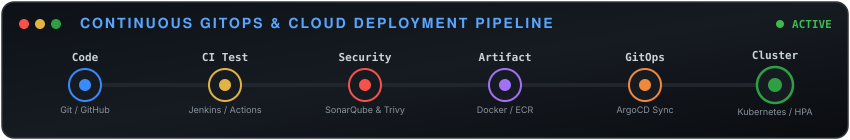

⚡ Shri Ganesh SuryawanshiCloud & DevOps Engineer · Bengaluru, India 

 

&nbsp;

&nbsp;

&nbsp;

&nbsp;

&nbsp;

&nbsp;

  🎯 Production Engineering Scorecard 🚀 Release Automation⚡ Infrastructure as Code🛡️ Shift-Left DevSecOps⏱️ Reliability & SRE-70% Manual OverheadAutomated ArgoCD & Jenkins GitOps-60% Environment SetupModular Terraform (2h → <45m)15+ Critical CVEs BlockedMandatory SonarQube & Trivy Gates40% Lower MTTDPrometheus & Grafana (99.9% Uptime)  🧠 Core Engineering Principles (The DevOps Mindset) "Most engineers focus only on tools. I focus on reliability, self-healing systems, and zero-touch automation." 🚫 Zero-ClickOps Policy: 100% of multi-cloud infrastructure (AWS & GCP) is declared, versioned, and provisioned using modular Terraform with remote S3 backend state and DynamoDB distributed locking.🛡️ Shift-Left Security First: Security is never an afterthought. SonarQube SAST analysis and Trivy container image scanning run as mandatory blocking quality gates on every Pull Request before artifacts reach production.🔄 Single Source of Truth (GitOps): Every cluster state change is stored in Git. ArgoCD continuously monitors repository states, automatically detecting configuration drifts and executing zero-downtime rolling releases with instant rollback.📈 SLO-Driven Observability: Proactive telemetry using Prometheus, Alertmanager, and Grafana dashboards to detect latency spikes and node pressure before they breach 99.9% customer SLAs.  🔁 Live Continuous Delivery Pipeline 

  🛠️ Technical Competencies & Ecosystem ┌─────────────────────────┬────────────────────────────────────────────────────────────────────────┐
│ DOMAIN                  │ TECHNOLOGIES & TOOLS                                                   │
├─────────────────────────┼────────────────────────────────────────────────────────────────────────┤
│ ☁️ Cloud Platforms      │ AWS (EC2, S3, IAM, VPC, RDS, Lambda, ECR, CloudWatch), GCP             │
│ 📦 Containers & K8s     │ Docker, Multi-Stage Builds, Kubernetes, Helm Charts, ArgoCD (GitOps)   │
│ 🔄 CI/CD & DevSecOps    │ GitHub Actions, Jenkins, GitLab CI, SonarQube SAST, Trivy Scanner     │
│ 🏗️ IaC & Automation     │ Terraform (Modular IaC), Ansible, Bash Scripting, Python, YAML         │
│ 📊 Observability & SRE  │ Prometheus, Grafana, Alertmanager, ELK Stack (Logstash/Kibana)         │
│ 🌐 Systems & Web Servers│ Linux Administration (Ubuntu, CentOS), Nginx, Reverse Proxy, SSL/TLS   │
└─────────────────────────┴────────────────────────────────────────────────────────────────────────┘
  🚀 Featured Production Architectures 1. 🏗️ Three-Tier High-Availability Cloud Architecture on AWSStack: AWS EC2 · Terraform · Docker · Nginx Reverse Proxy · PostgreSQL · SSL/TLSIsolated Network Architecture: Architected custom AWS VPC with public and private subnets, NAT gateways, and least-privilege Security Groups separating the presentation, business logic, and database tiers.Reusable Terraform Modules: Built declarative IaC templates supporting multi-environment deployments (Dev/Staging/Prod), cutting infrastructure provisioning time by 60% (from 2 hours to under 45 minutes).Production Reliability: Dockerized each tier with automated health-check endpoints and container restart policies, serving 500+ requests/minute at a 99% success rate with Nginx SSL/TLS termination.

<b>🔍 View Architecture Blueprint & Key Highlights</b>

 [ Internet Traffic (HTTPS:443) ]
               │
               ▼
   [ Nginx Reverse Proxy / SSL Termination ]
               │
      ┌────────┴────────┐
      ▼                 ▼
[ React Frontend ]  [ Node.js/Java API ]
      │                 │
      └────────┬────────┘
               ▼
     [ PostgreSQL Database (Private Subnet) ]
Automated infrastructure state locking using AWS DynamoDB + S3 versioned bucket.Zero exposure of database endpoints to public subnets.

 2. 🔄 Enterprise GitOps & DevSecOps Automated Delivery PipelineStack: Jenkins · GitHub Actions · SonarQube · Trivy · ArgoCD · Kubernetes7-Stage Continuous Delivery: Engineered a hands-off pipeline: Git Push $\rightarrow$ Maven Unit Test $\rightarrow$ SonarQube SAST Gate $\rightarrow$ Multi-Stage Docker Build $\rightarrow$ Trivy Image Scan $\rightarrow$ ECR Push $\rightarrow$ ArgoCD Sync.Shift-Left Vulnerability Prevention: Configured zero-tolerance quality gates that blocked 15+ critical CVEs from ever reaching production environments.40% Docker Optimization: Refactored Dockerfiles using multi-stage builds and Alpine slim base images, shrinking container image footprint by 40% and accelerating pipeline deployment speeds.

<b>🔍 View End-to-End Pipeline Flow</b>

 Developer Push ──► GitHub Actions CI ──► SonarQube Scan ──► Multi-Stage Docker
                                                                   │
Kubernetes (Zero-Downtime) ◄── ArgoCD GitOps ◄── ECR Registry ◄── Trivy Scan
Automated rollback mechanisms trigger in < 5 minutes upon container health-check failure.

 3. ☸️ Auto-Scaling Kubernetes Microservices with Full-Stack ObservabilityStack: Kubernetes · Helm · Prometheus · Grafana · Alertmanager · Horizontal Pod Autoscaler (HPA)Cloud-Native Deployment: Packaged 5 microservices into parameterized Helm charts with dynamic environment configs, Ingress path routing, and secret management.Elastic Load Handling: Configured Horizontal Pod Autoscaler (HPA) targeting 70% CPU and 80% memory thresholds, successfully scaling pods during stress tests of 1,000+ concurrent requests.Observability & MTTD Reduction: Deployed Prometheus and Grafana with 6 real-time monitoring dashboards, cutting Mean Time to Detect (MTTD) by 40% and ensuring 99.9% uptime compliance.  📈 Engineering Consistency & Activity 

  🎖️ Certifications, Honors & Achievements 📜 AWS Certified Cloud Practitioner (CLF-C02) – Amazon Web Services (2025)🎯 AWS Certified Solutions Architect – Associate (SAA-C03) – Target: 2026🌟 Top 10% Performer – DevOps Internship Cohort out of 200+ Engineers (QSpiders)🏆 Smart India Hackathon – State-Level Finalist (2023)  📬 Let's Connect & Build Resilient Cloud Systems I am actively open to Junior DevOps and Cloud Engineering roles, production automation projects, and networking with fellow platform engineers.

<a href="https://linkedin.com/in/ganesh-suryawanshi"><b>LinkedIn Profile</b></a> &nbsp;·&nbsp;
<a href="https://ganesh4365.github.io/Professional-Portfolio"><b>Live Portfolio</b></a> &nbsp;·&nbsp;
<a href="mailto:shriganeshsuryawanshi44@gmail.com"><b>Direct Email</b></a>

